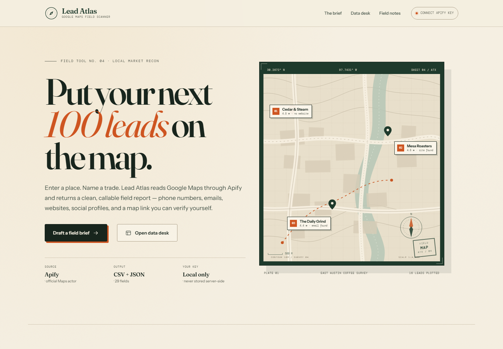
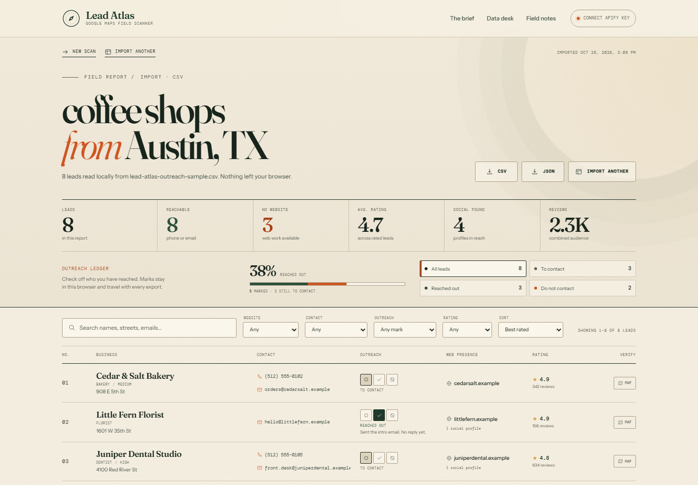

# Lead Atlas

A local-first Google Maps lead scanner. Give it a niche and a location, and it returns a
field report of businesses with phones, emails, websites, social profiles, ratings, and a
verification link to each Google Maps listing — plus an outreach trail so you know who you
have contacted. Ready to export as CSV or JSON.

Already have a lead file? The **Data desk** also imports an existing CSV, TSV, JSON, or
JSONL file and opens it in the same report UI. Imports are parsed entirely in the browser:
the file never leaves your device.

Lead Atlas is a small Node.js app that runs the official
[`compass/crawler-google-places`](https://apify.com/compass/crawler-google-places) Actor on
your own Apify account. There is no database and no account system. Your Apify token lives
in your browser and is sent only to your local server and then to Apify.





## Requirements

- Node.js 20 or newer
- An [Apify account](https://console.apify.com/sign-up) with a little credit
- An Apify API token ([Console → Integrations](https://console.apify.com/account/integrations))

## Quick start

```bash
npm install
npm start
```

Open <http://127.0.0.1:4317>, click **Add key**, and paste an Apify token. The app validates
the token with Apify before saving it to `localStorage`.

Then fill in the brief:

1. **Niche** — what to search for, e.g. `dentists`, `coffee roasters`, `emergency plumbers`.
2. **Location** — a city, region, or country, e.g. `Austin, TX` or `Lisbon, Portugal`.
3. **Website** — all places, only places with a website, or only places without one.
4. **Contact enrichment** — scrape emails and extra phone numbers when available.
5. **Minimum rating** and **skip closed places** — optional quality filters.
6. **Places** — 1 to 500 results.

Press **Run the scan**. Progress is polled live; when the Actor finishes, the report opens
with filters, search, sorting, a detail drawer, outreach tracking, and CSV/JSON downloads.

Open the **Data desk** from the header, report toolbar, or hero card to import an existing
lead file. Drop a CSV/TSV, JSON, or JSONL file — including a Lead Atlas export, an Apify
dataset, or a generic spreadsheet with headers — and it opens in the normal report with
filters, search, sorting, the lead drawer, outreach tracking, map links, and CSV/JSON
downloads.

## Scans survive a closed tab

A scan runs on Apify, not in your browser, so a closed tab, a refresh, or a crash does not
lose it. Reopen Lead Atlas within 24 hours and the app reconnects to the scan you were
watching:

- **Still running** — the live progress screen comes back, with the same run ID, elapsed
  time, and a "Reconnected" note.
- **Finished while you were away** — the report opens automatically; nothing to re-run.
- **The pointer** lives in `localStorage` under `leadAtlas.activeRun.v1`. It is cleared as
  soon as the report opens, the scan fails, or you abort — so it never hijacks a normal
  visit.

Reconnecting needs the same Apify account key saved in this browser, because that key is
what allows the app to read the run. Only the most recent scan is remembered; starting a
new scan replaces the pointer.

## One-click updates from GitHub

Lead Atlas is served from the same git clone it runs in, so the app can update itself the
same way you would: pull the newest commit and restart, in one click.

- On page load — and every 5 minutes after that — the app asks the local server to compare
  its build with the tip of your repository's branch on GitHub.
- When a newer commit exists, a **Update available** chip appears in the header. The footer
  always shows the build you are running (`Build <sha> · <branch>`).
- Click the chip and the server **stashes any uncommitted local edits**, fetches and resets
  to the remote tip, runs `npm install` only if `package.json` or the lockfile changed, and
  respawns itself onto the new build. The page waits for the new server, reloads, and
  confirms with a toast.
- Nothing is lost by default: pre-update edits go to a git stash, recoverable with
  `git stash list`. Brave-new-code days only: check `git status` before forcing anything.

The check goes through the GitHub REST API (fallback: plain `git ls-remote`) and is cached
for 60 seconds, so polling stays cheap. The browser never talks to GitHub directly.

Disable the feature with `SELF_UPDATE=off` — the chip disappears and `/api/update` answers
with a clear "turned off" message. Requirements: the folder must be a git clone of a
GitHub repository with `origin` set, and `git` must be on your PATH.

## Importing an existing lead file

1. Open the **Data desk** (no Apify key or scan required).
2. Drop a file onto the page or choose one from disk.
3. The file is parsed locally and the lead report opens automatically.

Imports support:

- Lead Atlas CSV and JSON exports
- Apify Google Maps dataset JSON, including nested `location` and `addressInfo`
- CSV, TSV, semicolon-delimited, and tab-delimited files
- JSON arrays, `{ "leads": [...] }` / `{ "items": [...] }` documents, and JSONL/NDJSON
- Common header aliases such as `Business name`, `Company`, `Phone Number`, `Email`,
  `Website`, `Instagram`, and `Place ID`
- Outreach columns such as `Outreach status`, `Contacted at`, `Outreach note`, `DNC`,
  `Contacted`, and `Last contacted`
- Up to 8 MB or 5,000 leads per file

Extra columns are preserved in the lead drawer and included in imported CSV/JSON exports.
Duplicate rows are merged by place ID, name + address, phone, or email. Outreach marks,
contact dates, and notes are restored from the file, so a Lead Atlas CSV or JSON export is
a complete backup of your call list. Imported exports are built in the browser, so they
work without an Apify key. Files are never uploaded or written to the server.

## Outreach tracking

Each lead carries one exclusive outreach state:

| State | Meaning |
| --- | --- |
| **To contact** | Still on the call list (the default) |
| **Reached out** | You have already made contact; the first mark is dated |
| **Do not contact** | Keep this business off future outreach |

Mark a lead from the three check buttons in the **Outreach** table column, from the filter
strip above the report, or from the **Outreach trail** section in the detail drawer. The
drawer also takes a private note of up to 280 characters — who answered, the best time to
call, or what you sent. Filter and sort by outreach state, and use the tally chips above
the table to jump between the next call list and the leads you have already handled.

Marks are stored in `localStorage` under `leadAtlas.outreach.v1`, keyed by place ID, then
phone, then email, then name + address. A new scan of the same market therefore keeps the
marks you already made. Nothing is sent to a server or to Apify.

CSV exports include `Outreach status`, `Contacted at`, `Outreach note`, and
`Outreach updated at`. JSON exports include the same data on each lead plus an
`outreach` count block in `report`. Re-importing either file restores the marks and notes.
A bare `To contact` cell is treated as the default; an explicit state, contact date, or
note from a file wins over the browser ledger.

## What you get

Each lead includes, when Apify provides it:

- Business name, category, address, city/region, postal code, country
- Phone numbers and emails
- Website, domain, and whether a website exists
- Rating, review count, price level
- Social profiles (Instagram, Facebook, LinkedIn, YouTube, TikTok, X, Pinterest, etc.)
- Latitude/longitude, place ID, closed status
- A **Google Maps verification link**
- Search niche, search location, scrape timestamp, and Apify run ID
- An outreach state, optional contact date, and private outreach note (browser-local)

### CSV

UTF-8 with a BOM, CRLF line endings, and formula-injection protection for spreadsheet
apps. The export includes one row per lead and a stable column order. Outreach columns
sit directly after `Emails`, so they are easy to spot in Excel or Google Sheets.

### JSON

```json
{
  "report": {
    "name": "Lead Atlas field report",
    "generatedAt": "2026-10-25T12:00:00.000Z",
    "searchNiche": "plumbers",
    "searchLocation": "Austin, TX",
    "apifyRunId": "…",
    "apifyActor": "compass/crawler-google-places",
    "totalLeads": 40,
    "summary": { "…": "…" },
    "outreach": {
      "total": 40,
      "toContact": 31,
      "contacted": 7,
      "doNotContact": 2,
      "marked": 9,
      "rate": 18
    }
  },
  "leads": [
    {
      "businessName": "Acme Plumbing",
      "phone": "(512) 555-0100",
      "emails": ["hello@acme.example"],
      "outreachStatus": "contacted",
      "outreachStatusLabel": "Reached out",
      "contactedAt": "2026-10-20T15:30:00.000Z",
      "outreachUpdatedAt": "2026-10-20T15:30:00.000Z",
      "outreachNote": "Spoke to Sam; send the menu",
      "googleMapsUrl": "https://www.google.com/maps/…",
      "…": "…"
    }
  ]
}
```

## How it works

```
Browser (vanilla HTML/CSS/JS)
  │  x-apify-token header
  ▼
Local Express server (127.0.0.1:4317)
  │  Authorization: Bearer <token>
  ▼
Apify API → compass/crawler-google-places → dataset
  │
  ▼
Normalization → report, CSV, JSON
```

- The server proxies every Apify request. The browser never calls Apify directly.
- Every run requests `scrapePlaceDetailPage: true` so website, contact, and detail fields
  are available.
- Dataset rows are normalized, deduplicated by place ID (or name + address), and merged
  when Apify returns the same place twice.
- Only one search string and one location are sent per scan. Reviews and images are
  disabled to keep runs fast and inexpensive.
- Run and dataset metadata are cached in memory. Restarting the server clears that cache;
  results already exported are unaffected.

## Cost and safety cap

Estimates use Apify's public **FREE-tier pay-per-event** rates. Paid plans are cheaper.
Prices can change; check the [Actor pricing page](https://apify.com/compass/crawler-google-places/pricing)
for the current numbers.

| Event | Estimate |
| --- | ---: |
| Run start | $0.007 |
| Place scraped | $0.004 |
| Place detail page | $0.002 |
| Contact enrichment | $0.002 per place |
| Each active filter | $0.001 per place |

Example: 40 places, contact enrichment on, skip-closed on, no rating filter:

```
40 × ($0.004 + $0.002 + $0.002 + $0.001) + $0.007 = $0.367
```

The UI rounds that to **$0.37**. The server sets Apify's `maxTotalChargeUsd` to
`max($0.50, estimate × 1.5)`, so this run is capped at **$0.56**. Apify stops the run if
spend reaches the cap. The estimate is a planning number, not a quote.

Contact enrichment is automatically disabled for **places without a website**, because
there is no site to enrich from. It uses the Actor's website-based company-contacts add-on;
the separate employee-level **business leads enrichment** add-on is intentionally left off
(`maximumLeadsEnrichmentRecords: 0`) to keep scans predictable and inexpensive.

## Security and privacy

- The Apify token is stored in `localStorage` under `leadAtlas.apifyToken.v1`. It is never
  written to a database, file, or server log.
- The token is sent to the local server in the `x-apify-token` header and forwarded to
  Apify as a Bearer token.
- **Forget key** removes it from the browser.
- The server binds to `127.0.0.1` by default. Do not expose it to the public internet: it
  is a local proxy for a personal API token and has no user authentication.
- API responses use `Cache-Control: no-store`; security headers include a strict CSP,
  `X-Frame-Options: DENY`, and `nosniff`.
- Cross-origin POSTs are blocked, and run/key endpoints are rate-limited per IP.
- The update endpoints follow the same rules: `/api/update` accepts same-origin POSTs only
  and is limited to 3 attempts per minute; `/api/version` is limited to 60 per minute. The
  updater talks to GitHub from the server, never from the browser.
- Scraped text is escaped before rendering and prefixed when it could be interpreted as a
  spreadsheet formula in CSV exports.
- Imported lead files are read with the browser `File` API and parsed in memory. Their
  contents are never sent to the local server, Apify, or any third party.
- Outreach marks and notes are stored only in this browser under
  `leadAtlas.outreach.v1`. They are included in files you download, but never uploaded.
- There is no telemetry. The only external requests are Google Fonts (page styling) and
  Apify (your scans). Fonts can be removed in `public/index.html` if you need a fully
  offline UI.

## Configuration

| Environment variable | Default | Purpose |
| --- | --- | --- |
| `PORT` | `4317` | Local HTTP port |
| `HOST` | `127.0.0.1` | Bind address |
| `APIFY_API_BASE` | `https://api.apify.com/v2` | Apify API base URL (used by tests) |
| `SELF_UPDATE` | on | Set to `off` (or `0`/`false`) to disable the one-click updater |
| `GITHUB_TOKEN` | — | Optional token sent to the GitHub API for private repos and higher rate limits |

```bash
PORT=4318 npm start
```

A `GITHUB_TOKEN` is not needed for public repositories. If you set one, it is only used in
the server's update check against `api.github.com` and is never sent anywhere else.

## Tests

```bash
npm test
```

The suite uses Node's built-in test runner and a local mock Apify server — no token or
network access required. It covers:

- Request validation, website/rating aliases, Actor input, and cost estimates
- Lead normalization, contact/social extraction, deduplication, and summaries
- Outreach normalization, stable lead keys, counts, note limits, and date handling
- CSV escaping, formula injection protection, JSON export, and filenames
- Browser-side CSV/TSV/JSON/JSONL import parsing, aliases, deduplication, extras,
  outreach fields, and export round-trips
- Active-scan records — parsing, brief normalization, URL and freshness rules for
  reattaching after a closed tab
- Self-update helpers (repository URLs, commit/ls-remote parsing, dependency detection),
  update/apply flows with injected git and fetch runners, and the version/update routes
- Server routes, token handling, origin checks, live status, abort, and exports

## Project structure

```
lead-atlas/
├── public/
│   ├── index.html        Page structure and dialogs
│   ├── styles.css        Design system and responsive layout
│   ├── app.js            UI state, polling, report, outreach, import desk, exports
│   ├── active-run-core.js Active-scan pointer parsing and freshness rules
│   ├── import-core.js    Browser-side CSV/JSON import parser and exports
│   ├── outreach-core.js  Outreach states, keys, notes, dates and counts
│   └── favicon.svg
├── src/
│   ├── server.js         Express app and API routes
│   ├── selfupdate.js     One-click git-based self-update (checks, apply, restart)
│   ├── apify.js          Apify HTTP client and error mapping
│   ├── validation.js     Brief validation, Actor input, cost estimate
│   ├── leads.js          Dataset normalization and summaries
│   ├── csv.js            CSV/JSON exports and filenames
│   ├── config.js         Actor, limits, pricing, security headers
│   └── errors.js         Typed API errors
└── test/
    ├── validation.test.js
    ├── leads.test.js
    ├── csv.test.js
    ├── import-core.test.js
    ├── outreach-core.test.js
    ├── active-run-core.test.js
    ├── selfupdate.test.js
    └── server.test.js
```

## Limitations

- Results are limited to what the Apify Actor returns; Google Maps data can be incomplete
  or stale.
- Contact enrichment depends on the business website and is best-effort. Some places will
  have no email.
- A scan is one niche + one location. Run separate scans for multiple areas.
- The browser tab can be closed mid-scan without losing the run — reopen the app within
  24 hours and it reconnects (see **Scans survive a closed tab**). Only the most recent
  scan is remembered, and place counts only advance while the tab is open, because the
  polling runs in your browser.
- The app is designed for local, single-user use. It has no multi-user authentication or
  persistent job queue.
- Outreach marks live in one browser profile. They do not sync between devices. Export
  the report to move the call list elsewhere, and re-import it to restore the marks.
- Clearing site data resets the outreach ledger. Export before clearing browser storage.
- The one-click updater syncs the working copy to the remote branch tip. Local uncommitted
  changes are swept into a git stash first; they are kept, but not merged back. If you
  develop in the same clone you serve, commit or stash your work as you would normally.
- Updates are only offered when a scan is not running, and the update check needs `git` on
  the PATH plus GitHub reachability. When either fails, the UI simply stays quiet.

## Troubleshooting

| Problem | Fix |
| --- | --- |
| `Port 4317 is already in use` | Run `PORT=4318 npm start` |
| `Apify rejected this API key` | Copy a fresh token from Console → Integrations |
| `Your Apify account has no available credits` | Add credit to Apify or use another account |
| A scan returns no places | Broaden the niche/location, raise the result count, or relax filters |
| “The report could not be pulled” after a completed run | Restart the server with the latest code. Apify names the run dataset `defaultDatasetId`; older builds looked for `datasetId`. |
| A file will not import | Use CSV, TSV, JSON, or JSONL under 8 MB. The file needs a business-name column or at least one phone, email, or website per row. The error message on the Data desk explains what was missing. |
| Imported report has no niche or location | That metadata was not in the file. The report still works; its heading falls back to the file name. |
| The scan says “lost contact” | Check Apify Console; the run may still be running there |
| Outreach marks disappeared | They are stored per browser profile. Export and re-import a CSV/JSON file to restore them, or check that site data was not cleared. |
| The update chip never appears | The folder may not be a git clone, `origin` may not point at GitHub, the working copy is detached, or `SELF_UPDATE=off` is set. Check `git remote -v` and `git status`. |
| Reopening the app jumps into an old scan | That is the resume feature. Start a new scan, open the report, or click **Abort scan** to clear it. Records older than 24 hours are ignored automatically. |
| A closed-tab scan did not come back | Resume needs the same Apify key in this browser, the scan must be under 24 hours old, and only the most recent scan is remembered. The run remains visible in Apify Console. |
| An update leaves old code running | Restart the terminal command once (`Ctrl+C`, `npm start`). `/api/update` always reports whether it respawned the server. |
| “Local changes could not be stashed” | The updater stops before touching anything. Inspect `git status`, commit or discard your edits, then click update again. |
| Recover pre-update edits | `git stash list` shows the snapshot (e.g. *Lead Atlas pre-update snapshot …*); `git stash pop` or `git stash apply` brings the edits back. |

## Disclaimer

Lead Atlas is not affiliated with Google or Apify. Respect Google's terms, Apify's terms,
and applicable privacy and marketing laws when using scraped business data.
